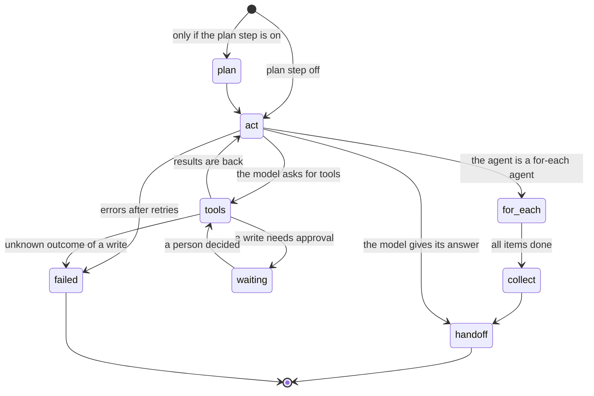

# Agent engine: proposed design

> **Status: PROPOSED. Not yet agreed.** Nothing on this page is built unless a line says so.
> What the OS does today is in [`how-an-agent-runs.md`](how-an-agent-runs.md).
> Section 8 lists the decisions the owner has to take before work starts.

Written 2026-11-19 against commit `b47e2cd5`. Paths are relative to `os-ui/` unless they start
with `charts/`, `docs/` or `values`.

## Contents

1. Principles
2. The central choice: who owns the agent loop
3. Target run design
4. Gateway design (LiteLLM)
5. Observability design (Langfuse)
6. Simple versus Developer settings
7. Decisions already taken
8. Decisions the owner must take

---

## 1. Principles

1. **Identity is the architecture.** Every tool call runs as the signed-in person, never as a service account. Model keys are managed centrally by admins; users have none. The gateway's master key is never in the browser and never on the run path.
2. **One loop, one place for policy and approval.** There is exactly one piece of code through which every tool call of every agent passes. It checks the grant, decides whether the call is held, and records the decision.
3. **What the model is sent is bounded separately from what is stored.** The run keeps everything. The model is sent a deliberate, limited selection.
4. **Everything a run does is visible in one trace.** One trace per run, one record per model call, one record per tool call.
5. **Simple works with safe defaults. Developer can override, within limits an admin sets.**
6. **No Enterprise-only features.** Only Apache-2.0, MIT, BSD and ISC components. LiteLLM Enterprise and Langfuse Enterprise Edition features are not used.

---

## 2. The central choice: who owns the agent loop

The "agent loop" is the cycle "ask the model, run the tools it asks for, give it the results, ask
again". Today the OS has its own loop and uses LangGraph only to order steps and save state
(`tabs/agents/lib/engine/build-graph.ts:820-1070`). There are two ways forward.

**Option A: keep an OS-owned loop, rebuilt on LangGraph's own parts.**
The OS keeps writing the loop, but stops writing by hand what LangGraph already provides:

| Job | LangGraph part used |
|---|---|
| Conversation per agent | message state with the library's merge rule |
| Retry of temporary failures | `RetryPolicy` |
| Time limits | node timeouts |
| One place for "what now" after a failure | `errorHandler` and graph-wide node defaults |
| Approval | `interrupt()` with an interrupt id and a response schema |
| "For each item" in parallel | `Send`, with `maxConcurrency` |
| One agent as a unit | a subgraph per agent |
| Live text and tool progress | the library's stream modes |
| Safe saving | an explicit durability mode |
| Memory across runs (optional) | `Store` |
| Run history | read-only, from checkpoints |

**Option B: adopt LangChain's `createAgent` with middleware.**
`createAgent` is the ready-made loop the LangChain documentation now recommends. Behaviour is
added through "middleware": small pieces that run before and after each model call and around
each tool call. Ready-made middleware exists for retry, model fallback, summarising, call limits
and human approval. The OS would write its policy and approval rules as middleware.

| | Option A (own loop on LangGraph parts) | Option B (`createAgent` + middleware) |
|---|---|---|
| New dependency | None | The `langchain` package (not installed today) |
| Policy, hold and identity in one audited place | Yes, by construction: the OS's tool step is the only way to a tool | Possible as a tool-call middleware, but the loop around it is not ours. Each upgrade of `langchain` has to be re-checked for a path around the middleware |
| Tool calling with open-weight models (the models in use) | We control parsing, checking, repair and forcing | We get what the library does. The research found open issues with structured output on some providers |
| Retry, fallback, summarising, call limits | We build them (from LangGraph parts and our own code) | Ready-made |
| Approval | We build it on `interrupt()` | Ready-made middleware, with a "one interrupt per call" mode |
| Amount of own code to maintain | More. This is the real cost of A | Less |
| Risk of the library changing under us | Low: LangGraph's core graph API was stable across the 1.0 release | Higher: `createAgent` and its middleware are new and change quickly |
| Tests with a scripted model | Our own scripted model (exists today) | `fakeModel` from `langchain` |
| Work to get there from today's code | Smaller: the graph, the tool executor, the queue and the approval bridge stay | Larger: the loop is replaced and every OS rule is re-expressed as middleware |

**Recommendation: A now.** Two reasons.

1. Every tool call must pass the OS's policy check, the hold and approval rules, and the hand-over of the person's identity, in one audited place. With A that place is our own code by construction.
2. The models in use are open-weight models. Their tool calling needs hardening (checking arguments, a repair turn, forcing a call where one is required). We need to control that ourselves.

**The cost of A, stated plainly.** We keep maintaining a loop. Today there are two copies of it
(defect F18). A is only worth it if we end with one copy and it is small. We will write
retry-after-rate-limit, summarising and old-result clearing ourselves, where B would give us
ready-made versions.

**Keeping the door to B open.** The loop will be written with the same hook points that
`createAgent` middleware has: before the agent, before the model call, around the model call,
around the tool call, after the model call, after the agent. Each OS rule (grant check, hold,
budget, redaction) is one such hook. If we move to B later, each hook becomes one middleware.

**Revisit after Phase 2**, with the benchmark numbers and the amount of own code in hand.

---

## 3. Target run design

### 3.1 One agent as a subgraph

Each agent becomes its own small graph (a "subgraph") inside the team's graph:

In words:

1. **Plan (optional).** Off by default. When on, one model call writes a short plan. It uses the agent's own model.
2. **Act.** One model call with the agent's tools.
3. **Tools.** The single place where a tool call is checked and executed. Then back to act.
4. **Hand-off.** The agent's answer and its results go to the next agent, or the run ends.

### 3.2 What the state holds

"State" is what is saved after every step.

| In state | Not in state |
|---|---|
| Each agent's conversation, as messages | Large tool results. They are stored once, outside the conversation, and the conversation holds a **reference**: tool name, size, a hash, a short preview |
| The task, the path of agents so far, budgets used | Images and file bodies |
| References to results, and each agent's final answer | Secrets of any kind |
| Declared state values (`state.channels`) | |

Today the state holds the raw results, up to 20,000 characters each, and they are saved again
after every step (`tabs/agents/lib/engine/checkpointer.ts:44-65`).

Where the results themselves are stored: a new table in the `agent_runs` database, next to the
run's events, deleted by the same 30-day sweep. This is a proposal; the Files store is the
alternative. Originals of uploaded files are always kept alongside any extracted text (owner
decision).

### 3.3 What the model is sent

For each model call the engine assembles the input fresh:

1. A short system prompt. Each tool is described **once**, in the `tools` part only. An agent sees only its own tools.
2. The task.
3. The agent's conversation so far, with this rule: the newest tool results are included in full (default: the last 3). Older results are replaced by one line, for example `[earlier result of get_file, 4,812 characters, reference r7. Ask for it again if you need it.]`
4. If the input is still above the agent's input budget (default 24,000 tokens), the oldest part of the conversation is replaced by a summary written by the fast model.

The model can ask for an old result again through a small built-in tool. Access to it follows the
same grants as the original call.

**At hand-off** the next agent receives the previous agent's answer, its structured results in
full, and references to its other results. Today it receives the first 800 and last 800
characters of each long result (defect F8).

### 3.4 "For each item": the 12-invoice example

Task: "Read the 12 invoices in this folder, extract the key fields, and write one summary table."

**Today.** One agent reads the files one after another in a single conversation. Every call
carries all earlier files again. A real run of the owner's two-agent invoice team used about
185,000 tokens in ten model calls and failed on the limit of 200,000 tokens per minute (seen live,
2026-11-19).

**Proposed.** The first agent is marked "process each item separately".

1. One call lists the folder. The list is the set of items.
2. The engine starts one small piece of work per item (LangGraph `Send`), at most 4 at a time (`maxConcurrency`).
3. Each piece of work is one model call: short instructions, one document, and a required structured answer (supplier, number, date, net, tax, gross, currency). It carries no history.
4. The 12 structured answers are collected into one list.
5. The second agent receives the list and writes the table.

Estimated token budget. **These are estimates, to be replaced by measurements** (see the benchmark in [`plan.md`](plan.md)). Assumption: each invoice is at most 4,000 characters of text, about 1,000 tokens.

| Step | Model calls | Tokens per call (in + out) | Tokens in total |
|---|---|---|---|
| List the folder | 1 | 1,500 + 200 | 1,700 |
| Extract, once per invoice | 12 | 1,600 + 250 | 22,200 |
| Write the table (second agent) | 1 | 3,600 + 1,200 | 4,800 |
| Save the result (second agent, one tool round) | 1 | 5,500 + 300 | 5,800 |
| **Total** | **15** | | **about 35,000** |

A range of 35,000 to 50,000 tokens is a fair expectation, against about 185,000 today. No single
call is larger than about 6,000 tokens, and no minute carries more than about 25,000.

Rules for "for each" in the first version:

- A piece of work that fails is recorded as "failed" for that item and does not sink the others. (In LangGraph, if one parallel branch throws an error, the whole step's results are discarded. So each piece of work catches its own errors and reports them as a result.)
- No held writes inside a "for each". Writes happen after the results are collected. Approvals inside parallel work are known to be fragile.
- A maximum number of items (default 50, the same as today's folder limit, `core/kernel/config.ts:622`).

### 3.5 Failure

- **A failed agent stops the run**, unless a failure hand-off is declared for that agent.
- "Failed" means: the model call or a tool call still fails after the retries in 3.6, or a required structured answer is still invalid after its repair turn, or the reply is empty twice.
- A run that ends this way is stored as **failed**, with a reason in plain words. Today it is stored as done (`tabs/agents/lib/build/run-jobs-server.ts:305-330`).
- Errors are not swallowed. One graph-wide error handler records them.

### 3.6 Rate limits and retries

The gateway answers "too many requests" (HTTP 429) for two different reasons. The engine tells
them apart first:

| Reason | What the engine does |
|---|---|
| **Out of budget** | No retry. The run stops with "Budget used up. It resets on <date>." |
| **Too fast** (requests, tokens or parallel calls per minute) | Wait and try again: start at about 2 seconds, double each time, at most 60 seconds, with a random part so parallel calls do not retry together. At most 5 tries. The UI shows "Waiting for the model gateway, try 2 of 5". |
| **Still too fast after 5 tries** | The run is **parked** as "throttled" and continues by itself from its checkpoint a little later. It is not failed. |

Also:

- Before calling, the engine limits its own parallel calls per key to the key's limit, and slows down when the gateway's "remaining" headers get low.
- Temporary server errors and timeouts are retried up to 3 times (`RetryPolicy`). Write tools are never retried automatically.
- **One layer owns retries: the engine.** Agent calls ask the gateway for at most one retry of its own, so one failed call is not multiplied.
- Time limits are made consistent, so the engine never gives up while the gateway is still working. Today the engine waits 240 seconds while the gateway may retry for longer (`core/runtime/runtime.ts:153`; `charts/sovereign-agentic-os/values.yaml:512-517`).

A first version of "wait and retry on 429" is in progress (PR #91, open, not merged).

### 3.7 Tool calling made safe for open-weight models

| Problem today | Proposed |
|---|---|
| Arguments that are not valid JSON become empty arguments and the tool runs (defect F10) | The call is **not** executed. The model gets the error and **one repair turn** to send it again. |
| Arguments are never checked against the tool's declared inputs | Checked before the tool runs. Same repair turn. |
| The supervisor "must" call `route`, but nothing forces it | The call is forced (`tool_choice`) where a call is required: supervisor decision, "for each" extraction. This needs a test against the gateway and the two models first. |
| A reply cut off at the length limit is not noticed | The stop reason is read. A cut-off answer is continued once or marked "cut off". A cut-off tool call is treated as invalid arguments. |
| An empty reply counts as success | One retry, then the agent fails. |
| A refusal is taken as the answer | Recorded as a refusal. The agent fails with that reason. |
| Several writes in one reply | Writes run one at a time, each after its own check and approval. |
| The text fallback throws away gathered results (defect F14) | The fallback keeps the conversation, and is triggered only by a test at Build that the model really cannot call tools. |

### 3.8 Approvals

- A held write pauses the run with LangGraph's `interrupt()`, one pause per held call.
- Each pause has its own id. The approver's answer is matched **by that id** and checked against a schema (approve or reject, optional note). An answer for an old or unknown pause is refused.
- **Every write carries an idempotency key**, built from the run id, the agent and the call id, all of which are saved before the write. The tool executor keeps a small record of keys it has executed. A second attempt with the same key is not executed again. This is what makes "continue after a pause or a crash" safe.
- If the outcome of a write is unknown (the worker died while it was in progress), the run stops and asks a person. It does not try again by itself.

### 3.9 Grants enforced when a tool runs

Today the grant lists are prompt text only (defect F6). Proposed:

- Each tool declares which of its inputs name a dataset, document, metric, connection, file or folder.
- The tool executor checks every such input against the system's grants, and the kind of access (read or write) against the grant's access level, **before** the tool runs. A call outside the grants returns "forbidden" to the model and is recorded.
- Folder grants are resolved to their contents at run time, for Files too.
- The prompt still lists what is granted, as help for the model. The sentence that other items are "DENIED" becomes true.
- The access level per grant decides what happens to a write: `Read` refuses it, `Write-approval` holds it for approval, `Write-bounded` executes it. The safety preset becomes the upper limit for what a grant may be set to, as the Simple builder already shows it (`tabs/agents/lib/access-levels.ts:96-120`).

---

## 4. Gateway design (LiteLLM)

| Topic | Proposal | Why |
|---|---|---|
| **Upgrade** | Phase 0: from 1.90.0 to the long-term-support line (1.108.12). Phase 3: to 1.109 or later, which the new tracing link needs. | 1.108.12 is past the fix versions of all four published advisories. Two smaller steps are safer than one large one while the gateway is exposed. Known changes on the way: from 1.103.0 a setting in the config file wins over the database; from 1.104.0 the old Langfuse sender changes how it sends. Both need a test before the switch. |
| **Network** | The gateway is reachable only inside the cluster. Admins reach its console through the OS at `/tools/litellm`, as they already can. | Owner decision pending (decision 2). |
| **Salt key** | Set `LITELLM_SALT_KEY` once, before the next model is stored in the gateway's database. Never change it afterwards. | Without it the master key is also the encryption key and cannot be rotated. |
| **Keys** | One key per agent system, with a **random** value created by the gateway. The value is stored **encrypted in the `agent_runs` Postgres database**, which the web process and the worker both already use. The encryption key comes from a Kubernetes Secret. If a system's key cannot be found, the run is refused with "Rebuild needed". No silent use of the shared key. | Today the value is guessable and lives in one process's memory (`core/infra/secrets.ts:21-40`). |
| **Budgets** | Every budget resets. Suggested defaults from the research: 10 USD per 30 days per system, plus a daily guard of about 2 USD that the OS checks itself until the gateway supports two windows on one key. A budget on the domain's team is the ceiling above that. The OS warns at 80 %. | A lifetime cap guarantees that every successful system eventually stops. The in-progress change (PR #92) uses a weekly window; see decision 5. |
| **Limits** | On every key: 60 requests per minute, 200,000 tokens per minute, 4 parallel calls for a Simple system. A developer may raise them up to the domain team's limits. | System keys have no parallel limit today. |
| **Prices** | One price list, written once in the chart, rendered into both the gateway's model definitions and the OS's price book. | The OS has prices (`charts/sovereign-agentic-os/values.yaml:1427`); the gateway has none. A gateway without prices may count every call as free, and then no budget triggers. Not verified live. |
| **What a model can do** | Runs read context size, tool support and image support from the gateway's `/model/info`. The OS's explicit image allow-list stays the authority for "may this model be sent an image". | Today these are fixed in OS code (`core/models/context-windows.ts:46-52`). |
| **Retries** | The engine owns them (3.6). Agent calls ask the gateway for at most one. | Avoids multiplying one failure. |
| **Redaction** | The gateway does not log prompt or reply text. | Today it logs both in full (`charts/sovereign-agentic-os/values.yaml:519-524`). |
| **Fallbacks** | Only to models that are on the calling key's list. Rebuild puts a system's fallback models on its key. | Otherwise a fallback is refused (suspected defect S1). |

**Per-system keys or one shared key?** The alternative is one shared key for all systems, with
budgets counted and enforced by the OS.

| | Per-system keys (recommended) | One shared key, OS-side budgets |
|---|---|---|
| Who enforces the budget | The gateway. It still holds if the OS has a bug | OS code. A bug means no limit |
| Models allowed per system | Yes, on the key | No |
| Rate limits per system | Yes | No: one busy system slows all others (this is today's situation) |
| What must be stored safely | One secret per system | Nothing new |
| Moving parts | A secrets table, key creation and deletion | A spend check before each call |

**Recommendation: per-system keys.** The gateway is the enforcement point and the record of
spend. Keeping the budget there means a mistake in OS code cannot remove the limit. The cost is
one small table of encrypted secrets.

---

## 5. Observability design (Langfuse)

"Observability" means being able to see afterwards what a run did.

1. **Exactly one trace per run, and exactly one generation per model call.** The gateway owns the generation, because it knows the real usage and cost. The OS records the steps, the agents and the tool calls, and stops writing its own second record of each model call.
2. **Linked by the standard trace header.** The engine sends the W3C `traceparent` header on every model call. The gateway's record then lands inside the run's trace. The two LiteLLM-specific fields used today are ignored by the gateway's newer sender.
3. **Masking on the way out.** One `mask` function on the SDK removes document and image content from every record before it leaves the OS: a file or image becomes its type, size and hash. Image prompts are never stored in traces (owner decision). The gateway's own content logging is off.
4. **Sessions mean conversations.** A session is one conversation, or one schedule for timed runs. Today it is the system id, which makes one endless session.
5. **Scores and golden runs.** The judge's verdict and user feedback are scores on the trace. Each system can keep a few "golden runs": a test input with the expected outcome, re-run before release.
6. **Retention run by the OS.** A sweep deletes traces older than the retention period through Langfuse's delete endpoint. Langfuse's own retention policies are Enterprise only.
7. **A separate upgrade track.** In this order, each step with its own test:

| Step | What | Risk |
|---|---|---|
| 1 | OS: move from the old `langfuse` SDK to the new one, version 5 (works with the deployed server 3.194.1) | A rewrite of the tracing code |
| 2 | Gateway: LiteLLM 1.109 or later with the `langfuse_otel` sender, content capture off; remove the old sender | Running both senders logs every call twice |
| 3 | Platform: ClickHouse 25.12 or later; Langfuse chart version 2 | The chart change is itself a migration |
| 4 | Langfuse server version 4, first in the mode that accepts old and new input | Needs about three times the ClickHouse disk during the data move |
| 5 | OS: move reads to the newer endpoints | The old read endpoints disappear in version 4's default mode |
| 6 | Switch version 4 to its final mode; SDK version 6 | — |

Until step 2 is done: keep the current link, set the gateway's content logging off, and turn the
OS's own model-call record into a plain span so usage is not counted twice.

Langfuse version 3 receives security fixes only until the end of January 2027.

---

## 6. Simple versus Developer settings

One table with every setting an agent system has in the target design.

- **Simple mode** column: the default, and whether the builder sees the setting ("shown") or not ("hidden").
- **Admin cap**: the limit a developer cannot go beyond. Admin caps are platform settings, not part of `system.yaml`.
- **Stored where**: the key in `system.yaml`. Keys marked *(new)* do not exist today.
- **Today**: **exists** (works today), **new** (does not exist), **inert** (can be set today but has no effect on a run), **fixed** (exists as a constant or an installation-wide setting, not per system).

| Setting | What it controls | Simple mode | Developer mode | Admin cap | Stored where | Today |
|---|---|---|---|---|---|---|
| Model per agent | Which model an agent thinks with. | "Auto": the fast model for read-only agents, the reasoning model for agents that write. Shown as a label, not editable. | Any model alias the system's key allows. | The list of aliases a builder may choose. | `agents[].model` | **exists**; ignored by the plan step |
| Fallback model | The model to try when the first one keeps failing. | The gateway's fallback. Hidden. | One alias per agent, or none. | Same list as above. | `agents[].fallback_model` *(new)* | **new** |
| Activity routing | Model per kind of activity. | Hidden. | Removed. | — | `routing.overrides` | **inert**; removed, replaced by the two rows above |
| Agent role line | One sentence that says what the agent is. | Shown. Sent to the model as the first line of its instructions. | Same. | — | `agents[].role` | **inert** (never sent to the model); becomes effective |
| Plan step | Whether the agent writes a plan before acting. | Off. Hidden. | Off, on, or "auto" (on when the agent has more than 5 tools). | — | `agents[].plan` *(new)* | **fixed**: always on, always the reasoning model |
| Tool rounds per agent | How many times an agent may go round "call tools, read results". | 10. Hidden. | 1 to the cap. | 50 | `agents[].limits.tool_rounds` *(new)* | **fixed**: 100 for the whole installation |
| Step budget per run | How much work the whole team may do in one run. | 60 steps. Hidden. | 10 to the cap. | 400 | `limits.steps` *(new)* | **fixed**: 400 for the whole installation |
| "For each item" | Whether an agent handles a list of items one by one, in parallel. | Off. Shown as a switch "Process each item separately". | On or off; where the list comes from. | — | `agents[].for_each` *(new)* | **new** |
| "For each" concurrency | How many items are handled at the same time. | 4. Hidden. | 1 to the cap. | 8 | `agents[].for_each.concurrency` *(new)* | **new** |
| "For each" maximum items | The most items one run will handle. | 50. Hidden. | 1 to the cap. | 200 | `agents[].for_each.max_items` *(new)* | **new** |
| Tool choice | Whether the model may, must or must not call a tool. | Automatic: forced where a call is required. Hidden. | auto, required, none, per agent. | — | `agents[].tool_choice` *(new)* | **fixed**: always `auto` |
| Parallel tool calls | Whether the model may ask for several tools in one reply. | Off for agents with write tools, on for read-only agents. Hidden. | On or off per agent. Writes always run one at a time. | — | `agents[].parallel_tool_calls` *(new)* | **new** (not sent today) |
| Structured final answer | Whether the agent's answer must follow a declared structure. | Off, except for "for each" items. Hidden. | A structure per agent; number of repair turns (0 to 2). | — | `agents[].output_schema` *(new)* | **new** |
| Temperature | How much the model varies its wording. | 0.2. Hidden. | 0 to 1. | — | `agents[].temperature` *(new)* | **fixed**: 0.2 |
| Maximum answer length | The most tokens the model may write in one reply. | 4,000. Hidden. | 256 to the cap. | The model's own limit. | `agents[].max_output_tokens` *(new)* | **fixed**: taken from the fast model, even for other models |
| Input budget | The most tokens sent to the model in one call. | 24,000. Hidden. | 4,000 to the cap. | 100,000 | `context.input_budget_tokens` *(new)* | **fixed**: about 118,880 |
| Summarising | When older conversation is replaced by a summary. | When the input budget is reached. Hidden. | Threshold (50 to 100 % of the budget); off. | — | `context.summarise_at` *(new)* | **new** |
| Old tool results | How many recent tool results stay in full in the model's input. | 3. Hidden. | 1 to 10; tools whose results are never cleared. | — | `context.keep_tool_results` *(new)* | **new** |
| Retries per step | How often a failed model call or read is tried again. | 3 tries for errors; 5 waits for rate limits. Hidden. | 0 to the cap. Writes are never retried. | 5 and 8 | `reliability.retries`, `reliability.rate_limit_waits` *(new)* | **new** (no retry today) |
| Time limits per step | How long a model call or a tool call may take. | 5 minutes per model call, 60 seconds per tool. Hidden. | Within the cap. | 10 minutes and 5 minutes | `reliability.model_timeout_s`, `reliability.tool_timeout_s` *(new)* | **fixed**: 240 seconds and 60 seconds |
| On failure | What happens when an agent fails. | The run stops. Hidden. | A failure hand-off to another agent. | — | `edges[]` with `type: on_failure` *(new)* | **new**; today the next agent starts anyway (defect F1) |
| Safety preset | The most a team may do with writes. | "Read only". Shown as four cards. Raised automatically when a write output is declared. | Any of the four. | The builder's role decides whether direct writes are allowed. | `safety_preset` | **exists**; three of the four behave the same |
| Access per grant | What the team may do with each granted item: read, write with approval, write directly. | Read. Shown per item. | Any level up to the safety preset. | Role, as above. | `grants.*[].capability` | **inert** at run time; becomes enforced |
| Approval behaviour | Who must approve a held write. | By the access level: writes with approval are held; an admin approves under "Read only". Hidden. | No override. | — | follows `safety_preset` and `grants` | **exists** |
| Memory across runs | Whether the team remembers facts from earlier runs. | Off. Hidden. | On, with a size limit. | On or off for the whole installation. | `memory.across_runs` *(new)* | **new**; `agents[].memory_md` (fixed notes) **exists** and stays |
| Budget amount and window | How much a system may spend, and when the count starts again. | 10 USD per 30 days. Shown, read-only. | Amount and window within the cap. | The domain's budget. | `budget.amount_usd`, `budget.window` *(new)* | **fixed**: 5 USD, never resets |
| Rate limits | How fast a system may call the model. | 60 requests per minute, 200,000 tokens per minute, 4 at once. Hidden. | Within the cap. | The domain's limits. | `rate_limits` *(new)* | **fixed** in code |
| Tracing redaction | How much of a run's content is written to Langfuse. | `strict` when the team has file or image inputs, otherwise `structure`. Hidden. | `strict` or `structure`. | An admin may force `strict`. Content capture at the gateway only with tenant-admin consent. | `tracing.redaction` *(new)* | **fixed**: one setting for the whole installation |
| Schedule | When the team runs by itself. | Manual. Shown: manual, timed, on event. | Same, plus the raw timing expression. | — | `schedule` | **exists**, but stored in two places that disagree; becomes one |
| Outputs | Where results are saved. | None. Shown. | Same. | — | `outputs[]` | **exists** |
| Hand-off conditions | When a hand-off is taken. | A straight chain. Hidden. | A condition per hand-off. | — | `edges[].when` | **exists**, only by editing the file; the proposer writes invalid text (defect F0) |
| State values | Named values agents can set and conditions can read. | None. Hidden. | Typed values. | — | `state.channels` | **exists**, only by editing the file |
| Evaluation: judge | Whether a run is scored by a model. | On demand, in the Evaluate step. Shown. | After every run. | — | `evaluation.judge` *(new)* | **exists** on demand |
| Evaluation: golden runs | Test inputs with expected results, re-run to catch regressions. | Off. Hidden. | Up to the cap. | 10 per system | `evaluation.golden_runs` *(new)* | **new** |

Not in this table, on purpose: which keys exist, the gateway's master key, and bypassing a key's
list of allowed models. A developer can never change those.

The Simple or Developer switch itself is remembered per browser today (`tabs/agents/ui/SystemView.tsx:115`). That stays.

---

## 7. Decisions already taken

These are encoded in the design above. They are listed so nobody re-opens them by accident.

| # | Decision |
|---|---|
| D1 | Approvals never go through assistants. An assistant may show that something is waiting; it cannot approve. |
| D2 | For a destructive action started through an assistant, the person's own click on Confirm is enough. (A confirmation gate for Ask the OS is in progress: PR #89, open.) |
| D3 | A Builder may approve their own deploy request. |
| D4 | Images go only to the EU-hosted Qwen3-VL, through an explicit admin list. Never from restricted files. Image prompts are not stored in traces. Limits: 3 images in view, 10 per run, about 1300 px, 5 PDF pages per run. |
| D5 | The original of a file is always kept alongside its extracted text. |
| D6 | Only Apache-2.0, MIT, BSD and ISC components. LiteLLM Enterprise and Langfuse Enterprise Edition features are not usable. |
| D7 | Every tool call runs as the signed-in person, never as a service account. |
| D8 | Model keys are managed centrally by admins. Users have none. |
| D9 | The LiteLLM master key is never in the browser and never on the run path. |

One point to check against D1: the description of the MCP tool `run_agent_system` tells its caller
to use `decide_approval` when a run parks (`core/mcp/agent-write-tools.ts:121`). Whether an
assistant can still decide an approval that way after the route hardening shipped in image tag
0.9.12 was not checked for this page.

---

## 8. Decisions the owner must take

Each can be answered with yes or no, or by picking one option.

1. **Who owns the agent loop?** Option A: we keep our own loop and rebuild it on LangGraph's parts. Option B: we adopt LangChain's ready-made agent and add our rules as middleware. **Recommendation: A, and look again after Phase 2.**
2. **Shall the model gateway stop being reachable from the internet?** Admins would open its console through the OS, as they can today. **Recommendation: yes, now.**
3. **Shall we upgrade the gateway in two steps (first to the long-term-support version to close the security advisories, later to the newest line for tracing), rather than one big step?** **Recommendation: yes, two steps.**
4. **One gateway key per agent system (random, stored encrypted in the database), or one shared key with budgets counted by the OS?** **Recommendation: one key per system.**
5. **What is the default budget for a system?** Option A: 10 USD per 30 days plus a daily guard of 2 USD. Option B: a weekly budget, as the change in progress (PR #92) does. **Recommendation: ship B now because it is already in progress, move to A when the upgraded gateway supports two windows on one key.**
6. **Shall a run stop when one agent fails, unless the builder has drawn a failure hand-off?** **Recommendation: yes.**
7. **Shall the planning call be off by default?** It roughly halves the model calls of a simple agent. A developer can switch it on per agent. **Recommendation: yes, off by default.**
8. **Shall traces contain no document and no image content by default, including in the gateway's records?** The cost: an admin can no longer read full prompts in Langfuse unless a system is switched to the less strict level. **Recommendation: yes.**
9. **Shall teams be able to remember facts across runs?** **Recommendation: not now. Keep it off and decide after Phase 2.**
10. **Shall traces be deleted after the same period as run data (30 days by default)?** **Recommendation: yes.**
11. **When a write may or may not have happened (the worker died mid-write), shall the run stop and ask a person instead of trying again?** **Recommendation: yes.**
12. **When the definition was changed after the last Build: shall Run rebuild automatically in Simple mode, and show "Rebuild needed" in Developer mode?** **Recommendation: yes to both.**
13. **Shall the Langfuse upgrade to version 4 be finished before the end of January 2027, when version 3 stops receiving security fixes?** It needs more database disk for a while and a planned maintenance window. **Recommendation: yes.**
