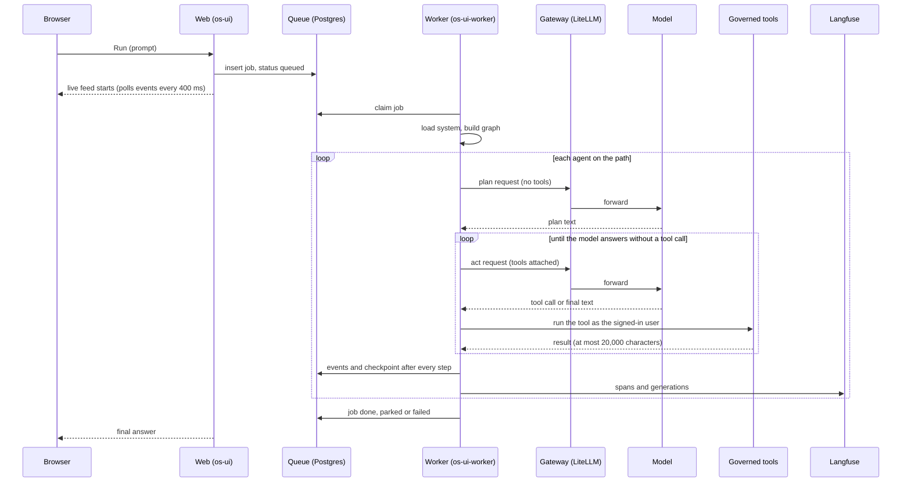
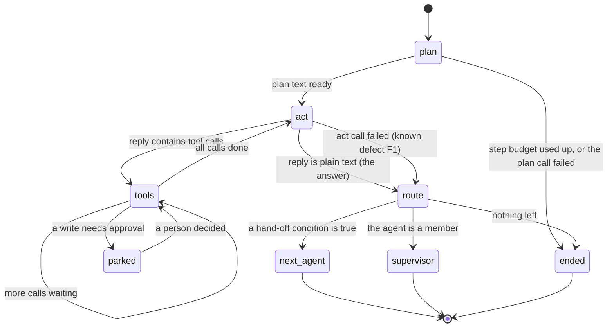

# How an agent runs today

This page describes what the code does **today**. It is not the plan. The plan is in
[`design.md`](design.md).

Verified against commit `b47e2cd5` (main, 2026-11-19) by reading the code. Nothing on this page was
measured by running it, except where a line says "seen on the live system".

Paths are relative to `os-ui/` unless they start with `charts/`, `docs/` or `values`. A reference
like `runtime.ts:224-232` means lines 224 to 232 of that file.

## Words used on this page

| Word | Meaning |
|---|---|
| Agent system | One team of agents that you build in the Agents tab. It is stored as one text file, `system.yaml`. |
| Agent | One member of the team. It has instructions and a list of tools it may use. |
| Tool | A governed action the OS offers, for example `get_file` or `query_data`. |
| Model call | One request to the language model and its reply. |
| Token | The unit a model counts text in. Roughly four characters of English are one token. |
| Gateway | LiteLLM. Every model call goes through it. It holds the keys, the limits and the spend record. |
| Checkpoint | A saved copy of the run's state. A run can continue from it after a pause or a restart. |
| Step (superstep) | One unit of work in the graph engine. A checkpoint is written after each one. |
| Hand-off | One agent finishes and the next agent starts. |
| Supervisor | An agent that has `members` and decides which member works next. |
| Park | The run stops and waits for a person to approve a write. |
| Trace | The record of a run in Langfuse: which steps ran, which model calls were made, which tools were called. |

## The short version

1. You describe a team in `system.yaml`: agents, their instructions, what they may use, who hands off to whom.
2. **Build** checks that the file is valid and registers the team with three other services.
3. **Run** puts a job in a queue. A worker picks it up and walks the team's graph, one agent at a time.
4. For every agent the engine first asks the model for a plan, then lets the model call tools in a loop until it writes an answer.
5. Each tool call is checked, then executed as the person who started the run.
6. A write that needs approval parks the run until someone decides.
7. The last agent's answer is the result. Everything is recorded in Langfuse.

The engine is a real LangGraph graph. LangGraph is used to order the steps and to save
checkpoints. The tool loop, the supervisor, the model client, the trimming of long conversations
and the live progress feed are written by hand (`tabs/agents/lib/engine/build-graph.ts:755-1154`).
[`feature-map-langgraph.md`](feature-map-langgraph.md) lists this feature by feature.

---

## (a) What an agent system definition contains

The definition is one file, `system.yaml`. The code that reads it is
`tabs/agents/lib/system-schema.ts:459-521`. The code that checks it for sense is
`tabs/agents/lib/langgraph-compile.ts:50-121`.

| Part | What it is | Default | What it does in a run today |
|---|---|---|---|
| `system.name`, `system.domain`, `system.visibility`, `system.description` | Title, owning domain, who can see it, the goal in one sentence | `Untitled system`, empty, `Personal`, none | Name and description are shown and used by the judge. Visibility and domain in the file are **not** the authority: the stored record is (`tabs/agents/lib/store.ts:623-628`, `:947-978`). |
| `entrypoint` | The agent that starts | none | Must be a declared agent (`langgraph-compile.ts:58-61`). |
| `agents[].id` | Technical name of an agent | required | Used in step names and in the progress feed. |
| `agents[].role` | One-line description of the agent | empty | **Never sent to the model** (`langgraph-compile.ts:79-88`). Shown in the UI only. |
| `agents[].agent_md` | The agent's instructions | empty | Sent as part of the system prompt. |
| `agents[].memory_md` | Fixed notes the agent should always know | empty | Appended to the prompt unless empty (`tabs/agents/lib/build/agentic-graph.ts:491-492`). It is static text. Nothing writes to it during a run. |
| `agents[].tools` | The tools this agent may use | all of the system's tools | Can only narrow the system's list (`langgraph-compile.ts:67-73`). |
| `agents[].model` | Which model the agent uses | `auto` | Used for the act step. **Ignored for the plan step**, which always uses the reasoning model (`tabs/agents/lib/engine/build-graph.ts:782-787`). |
| `agents[].members` | Makes the agent a supervisor of these agents | none | The supervisor picks the next member with one extra model call (`build-graph.ts:1157-1196`). |
| `edges[]` | Hand-offs (`from`, `to`, optional `when` condition) | none | First hand-off whose `when` is true wins (`build-graph.ts:1099-1106`). |
| `grants.tools[]` | The system's tool list | `search_knowledge` | The only grant that is enforced at run time (`tabs/agents/lib/build/os-tools.ts:613-642`). |
| `grants.data[]`, `knowledge[]`, `metrics[]`, `connections[]`, `files[]`, `plan[]` | Which datasets, documents, metrics, connections, folders and plan items the team may use, each with an access level | empty | **Written into the prompt only.** Nothing checks a tool call against them. See [`known-defects.md`](known-defects.md), F6. |
| `safety_preset` | How writes are treated | `read-only` | Under `read-only` every write tool is held for an admin. The other three presets behave the same as each other (`tabs/agents/lib/build/hold.ts:230-253`). |
| `state.channels` | Named values agents can set and hand-off conditions can read | `messages` | Typed values work. The `messages` channel is never written by any step (`build-graph.ts:426-435`; no step returns a `messages` update). |
| `routing.overrides` | Model per kind of activity | empty | **No effect on a run.** Read only by Build and a Monitoring view (`tabs/agents/lib/build/live.ts:101-108`). |
| `schedule` | Manual, timed or on event | manual | The file's value is only displayed. The stored record's value drives the timer (`tabs/agents/lib/store.ts:1109-1115`). |
| `outputs[]` | Where results are saved | none | Used by "Save result" after a run. |
| `ui.positions` | Where boxes sit on the canvas | none | Display only. |

Three things to know:

- Unknown keys in the file are dropped the next time the builder saves it (`system-schema.ts:547-569`).
- Some settings live in two places (the file and the stored record) and are never synchronised: name, visibility, domain, schedule.
- The system record is kept in the memory of the web process with a best-effort copy in OpenSearch. It is not in Postgres (`store.ts:271-315`).

---

## (b) What Build does

Build starts at `POST /api/agents/systems/[id]/build` (`app/api/agents/systems/[id]/build/route.ts:31-62`).

1. Check that you may edit the system.
2. Lower any direct-write grant the owner's role no longer allows (`tabs/agents/lib/build/owner-grants.ts:30-37`).
3. Ask the gateway whether it is reachable (`tabs/agents/lib/build/live-clients.ts:206-209`).
4. Parse and check the file. If that fails, Build shows one failed row and stops (`tabs/agents/lib/build/orchestrate.ts:19-52`).
5. Run four adapters in order. Each one does an "apply" and then a "verify". A row is green only if both pass.
6. If the gateway row is green, remember a reference to the system's gateway key (`build/route.ts:50-53`).
7. Save the result as "last build" on the system record.

There are **four** adapters, in this order (`tabs/agents/lib/build/live.ts:158-270`):

| Adapter | Apply | Verify | What is stored | Does a run use it? |
|---|---|---|---|---|
| **Policy (OPA)** | Writes the system's tool list under the name `os-<systemId>` into the policy service. If a connection needs approval, adds it to a shared approval list. | Asks the policy service three questions: is a granted tool allowed, is an invented tool refused, is a held connection tool held. | In the policy service's memory only. Lost when that service restarts (`live-clients.ts:60-63`). | **No.** A run works out the tool check itself from the file (`os-tools.ts:35-43`, `:613-642`). |
| **Gateway (LiteLLM)** | Looks for a key named `os-<systemId>`. **If it exists, does nothing** (`live.ts:197-198`). Otherwise creates it with a 5 USD lifetime budget, 120 requests per minute and 200,000 tokens per minute (`live.ts:82-87`; `live-clients.ts:127-139`). | Looks the key up again. Then checks a table inside the OS, not the gateway (`live.ts:222-228`). No model call is made. | A key in the gateway. The key's value in the memory of the web process (`core/infra/secrets.ts:21-40`). | **Rarely.** See below. |
| **Graph (LangGraph)** | Builds the real graph with a stand-in model and stand-in tools (`tabs/agents/lib/build/compile-verify.ts:66-83`). | Builds it again and reports the number of steps and warnings. | Nothing. | The run builds the graph again itself, every time (`tabs/agents/lib/engine/run.ts:177-229`). |
| **Tracing (Langfuse)** | Nothing (`live-clients.ts:156-159`). | Counts earlier traces for this system. Zero means "pending", not "failed". | Nothing. | Not applicable. |

**Rebuild re-does:** the policy write, the two graph builds, the trace count, and the "last build" stamp.

**Rebuild skips:** everything about the gateway key once it exists. Its models, budget and limits
are never updated (`live.ts:197-198`). A change that makes Rebuild reconcile the key is in
progress (PR #92, open, not merged).

**What Build does not tell you:**

- A run does not need a green Build. Nothing in the run path reads "last build ok" (`tabs/agents/lib/build/run-service.ts:280` is the only use, and it reads the key reference).
- Nothing notices that you changed the file after a green Build. The button says "Rebuild" as soon as any build exists (`tabs/agents/ui/BuildRunPanel.tsx:769`, `:980`, `:1209`).
- The key's value is the guessable text `sk-os-<systemId>` (`live-clients.ts:95-106`).
- The key's value is kept only in the memory of the web process that handled the Build. The worker is a different process, so it cannot find the value and uses the shared key instead (`core/infra/litellm-credential.ts:108-111`). Production runs in worker mode (seen on the live system, 2026-11-19), so in production runs use the shared key.
- A Build through the MCP tool `build_agent_system` creates the key but does not save "last build" (`core/mcp/agent-write-tools.ts:109-114`).

---

## (c) A run, from click to answer



The same thing as a numbered list, with the code for each step:

1. **Request.** The route checks who you are and that you may run the system. A tool grant with no real tool behind it stops the run with an error (`app/api/agents/systems/[id]/run/route.ts:116-126`). If you typed nothing, a default prompt is used (`:55-63`). The run gets an id `run_<uuid>`. The same id is the graph's thread id and the Langfuse trace id (`core/kernel/run-id.ts:18-20`).
2. **Queue.** A row is inserted into `run_jobs` with status `queued` (`tabs/agents/lib/engine/jobs-postgres.ts:49-66`, `:146-160`).
3. **Who executes.** In production a separate worker pod claims the job. The chart's default is the opposite: the web process runs it itself (`charts/sovereign-agentic-os/values.yaml:1408-1409`). The worker runs **one job at a time** and there is one worker (`tabs/agents/lib/engine/worker-loop.ts:176-180`; `charts/sovereign-agentic-os/templates/os-ui-worker.yaml:40`).
4. **Live feed.** The web route does not run anything. It reads the `run_events` table every 400 ms and forwards new rows to the browser, for at most 240 seconds per connection (`tabs/agents/lib/engine/jobs.ts:363-399`; `run/route.ts:36`, `:172-201`).
5. **Checks before the run.** The worker checks again that the person still exists, is enabled and still has the role and domain (`tabs/agents/lib/build/run-jobs-server.ts:273-279`). Folder grants are expanded to at most 50 items per folder (`tabs/agents/lib/build/os-tools.ts:206-249`).
6. **Set-up.** The engine parses the file, loads prices, prepares the model client and the tool executor, builds the shared prompt opening once per run, and reads the limits: 100 tool rounds per agent visit and 400 steps per run by default (`tabs/agents/lib/build/agentic-graph-server.ts:308-424`; `core/kernel/config.ts:377`, `:383`).
7. **Graph.** The graph is built again for every run and every resume (`tabs/agents/lib/engine/run.ts:177-229`). Each agent becomes four steps: plan, act, tools, route (`build-graph.ts:755-1154`).
8. **Plan.** One model call on the reasoning model asks for a short numbered plan. No tools are attached (`build-graph.ts:766-817`).
9. **Act.** One model call with the tools attached. If the reply contains tool calls, go to step 10. If not, the reply text is the agent's answer; go to step 12 (`build-graph.ts:820-885`).
10. **Tools.** First the engine decides, for all calls in the reply, whether any write must be held. If so, the run parks (step 14). Otherwise the calls are executed one at a time, in order (`build-graph.ts:896-1070`).
11. **Back to act.** The tool results are added to the conversation and the model is called again. Steps 9 to 11 repeat.
12. **Route.** The visit is recorded. Then: the first hand-off whose condition is true starts the next agent. Otherwise control returns to the supervisor if there is one. Otherwise the run ends (`build-graph.ts:1073-1144`).
13. **Supervisor.** A supervisor makes one model call with a single tool named `route` to pick the next member or to end (`build-graph.ts:1108-1137`, `:1157-1196`).
14. **Approval.** A held write creates an approval request and pauses the graph (`build-graph.ts:902-956`; `tabs/agents/lib/engine/approvals-bridge.ts:38-70`). The job becomes `parked`. When someone decides, the job is queued again and the tools step starts over. Approved calls run. Rejected calls return an error to the model, and the model carries on (`build-graph.ts:1024-1031`).
15. **End.** The result is assembled: the path of agents, the final text, and notes if a limit was hit (`tabs/agents/lib/engine/run.ts:231-265`). The job becomes `done`, `parked` or `failed`.

The four steps of one agent, as a state diagram:



**How agents see each other's work.** They do not share a conversation. Each agent gets a block
called "TEAM PROGRESS SO FAR" in its own system prompt, with the earlier agents' answers and a
shortened copy of their tool results (`tabs/agents/lib/build/agentic-graph.ts:319-335`). Any text
result longer than about 2,000 characters is cut to its first 800 and last 800 characters
(`core/infra/context/context-assembler.ts:75-79`, `:147-152`). A document read by the first agent
therefore does not reach the second agent.

**What "steps used" counts.** One for each agent visit, one for each model reply that contains
tool calls (however many), one for each supervisor decision (`build-graph.ts:812`, `:879`, `:1124`).
The default limit is 400. A limit of 12 was seen on the live system. No default in the code or the
chart produces 12. Where it comes from is not known.

**What is saved.** The whole run state after every step, including full tool results, in Postgres
(`tabs/agents/lib/engine/checkpointer.ts:44-65`). Runs that finished more than 30 days ago are
deleted by a sweep; parked runs are never deleted (`tabs/agents/lib/engine/retention.ts`).

**After a restart.** A worker that is asked to stop puts the job back in the queue and the run
continues from its last checkpoint (`run-jobs-server.ts:310-315`). After a crash the job is retried
once, then marked failed (`run-jobs-server.ts:82`; `jobs-postgres.ts:239-256`). The step that was in
progress runs again, so one model call or one tool call can happen twice.

---

## (d) What is sent to the model

Every model call of a run goes through one function, `liteLlmCaller`
(`core/runtime/runtime.ts:173-248`). It sends an HTTP POST to the gateway at
`/v1/chat/completions`.

### Which key and which model

| Question | Answer today | Where |
|---|---|---|
| Which key? | The system's own key if this process has its value in memory. Otherwise the shared key. If neither exists, the call is refused. The master key is never used. | `core/infra/litellm-credential.ts:102-112` |
| Which model for the plan step? | Always the reasoning model (`sovereign-reasoning` by default). | `build-graph.ts:783`; `core/models/roles.ts:67-96` |
| Which model for the act step? | The agent's pinned model if set. Otherwise "auto": an agent with a write tool or no tools gets the reasoning model; an agent with read-only tools gets the fast model, unless its instructions contain a word such as "plan", "decide" or "assess". | `tabs/agents/lib/build/agentic-graph.ts:258-269`; `tabs/agents/lib/routing.ts:267-290` |
| How long may the conversation get? | 118,880 tokens with the default models, estimated as characters divided by four. | `agentic-graph-server.ts:86-88`; `core/models/context-windows.ts:107-123` |

### How the system prompt is put together

In this order (`tabs/agents/lib/build/agentic-graph.ts:488-497`; `agentic-graph-server.ts:127-224`):

1. Team rules. Fixed text, about 190 tokens.
2. "WORKSPACE": one line per area of the OS the grants touch.
3. "YOUR GRANTED CONTEXT": the ids of granted datasets, documents and so on. Folder grants for Files are left out.
4. "YOUR GRANTED TOOLS": one line per tool **of the whole system**, not of this agent.
5. "YOUR ROLE IN THE TEAM": the agent's `agent_md`, then its `memory_md`.
6. For every agent after the first: the hand-off instruction and "TEAM PROGRESS SO FAR".
7. For an agent with a conditional hand-off: the list of state channels it can set.

### Example: the plan request

The example team has two agents in the domain `legal`. `reader` may use `get_file` and hands off to
`writer`, which may use `search_knowledge` and `upload_file`. The OS adds helper tools on its own:
`get_file` brings `list_files` and `search_files` with it (`os-tools.ts:96-111`).

This is an **illustration built from the code**, not a captured request. Values in angle brackets
are filled in at run time. Long texts are shortened with a marker that says how much was left out.
Sizes are estimates.

```json
{
  "model": "sovereign-reasoning",
  "messages": [
    {
      "role": "system",
      "content": "You are one agent in a governed team inside the Sovereign Agentic OS — a sovereign\nplatform where nothing leaves the tenant boundary.\n- Every tool call runs under the RUNNING USER's delegated identity: OPA-authorized,\n  role-gated and Langfuse-audited. [… about 520 characters of team rules]\n\n--- WORKSPACE (the OS areas your grants touch) ---\n[… one \"Purpose:\" line per area, about 400 characters]\n\n--- YOUR GRANTED TOOLS (your complete, authoritative toolset) ---\nYou may call ONLY the tools listed here — this is your COMPLETE toolset. Any tool\nnot on this list is NOT available to you; do not attempt it or reference it as an\noption. Consume granted resources by reference via the tools you hold.\n\n- get_file — [… about 700 characters]\n- list_files — [… description]\n- search_files — [… description]\n- search_knowledge — [… description]\n- list_knowledge — [… description]\n- upload_file — [… about 1,200 characters]\n\n--- YOUR ROLE IN THE TEAM: reader ---\n<the agent's instructions>\n\nFirst, think step by step and produce a SHORT numbered plan (3-6 steps) for how\nyou will fulfil the request using the available tools. Output only the plan."
    },
    { "role": "user", "content": "<the task you typed>" }
  ],
  "temperature": 0.2,
  "max_tokens": 4000,
  "user": "os-<userId>",
  "metadata": {
    "tags": ["domain:legal", "agent:<systemId>", "tab:agents", "run:<runId>", "env:studio"],
    "existing_trace_id": "<runId>",
    "parent_observation_id": "<id of the OS record of this call>",
    "trace_user_id": "<userId>",
    "session_id": "<systemId>"
  }
}
```

Points to notice:

- No tools are attached. The model is asked to plan "using the available tools" from the one-line list only (`build-graph.ts:782-787`; `core/runtime/agentic.ts:266-273`).
- `reader` is told about all six tools of the system although it may use three. Calling one of the others returns "not found" (`build-graph.ts:404-410`).
- Estimated size: 1,300 to 1,500 tokens going in.
- The key is sent in the `authorization` header and never appears in the body.

### Example: the first act request

```json
{
  "model": "sovereign-default",
  "messages": [
    {
      "role": "system",
      "content": "[… the same opening as in the plan request, up to and including the agent's instructions]\n\nYou now EXECUTE this plan by calling the available tools. Do real work — do not\njust describe it. Call one tool at a time; use each result to decide the next\nstep. When the goal is met, stop and give a concise final summary of what you\ndid (files committed, preview URL, deploy-review status).\n\nDISCOVER BEFORE YOU ACT — never guess identifiers:\n- FILES: use list_files / search_files to find the exact file before reading it.\n\nYour plan:\n<the plan text from the previous call>\n\nAvailable tools:\n- get_file: [… full description, about 700 characters]\n- list_files: [… full description]\n- search_files: [… full description]\n"
    },
    { "role": "user", "content": "<the task you typed>" }
  ],
  "tools": [
    { "type": "function", "function": { "name": "get_file", "description": "[… the same description again, about 700 characters]", "parameters": { "type": "object", "properties": { "…": "…" }, "required": ["…"] } } },
    { "type": "function", "function": { "name": "list_files", "description": "[…]", "parameters": { "…": "…" } } },
    { "type": "function", "function": { "name": "search_files", "description": "[…]", "parameters": { "…": "…" } } }
  ],
  "tool_choice": "auto",
  "temperature": 0.2,
  "max_tokens": 4000,
  "user": "os-<userId>",
  "metadata": { "…": "as in the plan request" }
}
```

Points to notice:

- The description of `get_file` is in this request **three times**: in the granted-tools list, in "Available tools", and in the `tools` array (`core/runtime/agentic.ts:307-325`; `:225-230`).
- The sentence "(files committed, preview URL, deploy-review status)" is wording for software-building teams. It is sent to every agent of every team (`agentic.ts:315`).
- Estimated size: 1,800 to 2,100 tokens of messages plus about 420 tokens of `tools`. The length check does not count the `tools` part (`agentic.ts:348-358`).

### The act request after a tool call

The same request is sent again with two messages added at the end (`build-graph.ts:870-876`, `:971-974`):

```json
{ "role": "assistant", "content": "<any text the model wrote>", "tool_calls": [ { "id": "<id from the model, or call-0>", "type": "function", "function": { "name": "get_file", "arguments": "{\"fileId\":\"…\"}" } } ] },
{ "role": "tool", "tool_call_id": "<same id>", "content": "<tool result text, at most 20,000 characters>" }
```

Every earlier call and result of this agent's visit is sent again, in full, on every later call.
After one large file the request is about 7,000 tokens. After ten it is about 52,000. Nothing is
shortened until about 118,880 tokens. These are estimates from the code's own formula.

On the live system, one run of a two-agent invoice team used about 185,000 tokens in ten model
calls, about 20,000 tokens per call by the gateway's limit counter. That is higher than the
estimate above. The difference is not explained. It has to be measured; see the benchmark in
[`plan.md`](plan.md).

### Every parameter sent

| Parameter | Value today | Where |
|---|---|---|
| `model` | See "Which key and which model" | `runtime.ts:181` |
| `messages` | System prompt, the task, then earlier calls and results of this visit | `build-graph.ts:849-858` |
| `temperature` | Always `0.2` | `runtime.ts:183`; every caller passes 0.2 |
| `max_tokens` | 4,000 with the default fast model. Taken from the fast model even for plan calls on the reasoning model. | `agentic-graph-server.ts:358`; `core/models/context-windows.ts:46-52` |
| `tools` | Only when the agent has tools and the step is "act" or the supervisor decision | `runtime.ts:187-190` |
| `tool_choice` | Always `"auto"` when `tools` is sent | `runtime.ts:189` |
| `user` | `os-<userId>` | `core/infra/litellm-credential.ts:91-93` |
| `metadata.tags` | `domain:`, `agent:`, `tab:`, `run:`, `env:` | `litellm-credential.ts:103-107` |
| `metadata.existing_trace_id` | The run id | `runtime.ts:196-202` |
| `metadata.parent_observation_id` | The id of the OS's own Langfuse record of this call | `runtime.ts:196-202` |
| `metadata.trace_user_id`, `metadata.session_id` | The user id and the system id | `runtime.ts:196-202` |
| HTTP header `authorization` | `Bearer <key>` | `runtime.ts:211` |
| Client time limit | 240 seconds | `runtime.ts:153` |

### Every parameter **not** sent

| Parameter | What it would do | Effect of not sending it |
|---|---|---|
| `stream` | Deliver the reply word by word | No live text in the UI. Only step-level progress. |
| `parallel_tool_calls` | Tell the model whether it may ask for several tools at once | The model decides. Several calls in one reply are run one after another. |
| `response_format` | Force the reply into a given structure | Final answers are free text. |
| `tool_choice` other than `auto` | Force a tool call | The supervisor is told it "must" call `route` but nothing forces it. |
| `stop`, `seed`, `top_p`, `n` | Fine control of the reply | Model defaults apply. |
| `reasoning_effort` | How much the model thinks before answering | Model default applies. |
| `cache` | Use the gateway's reply cache | Agent runs are never served from cache. |
| A prompt-cache marker | Let the provider reuse an unchanged prompt opening | No reuse. |
| A header that limits gateway retries | Keep one layer in charge of retries | The gateway retries provider errors up to three times by itself (`charts/sovereign-agentic-os/values.yaml:512-517`). |
| W3C `traceparent` header | Link the gateway's record to the run's trace in the standard way | Linking relies on the two `metadata` ids above. |

---

## (e) What happens with the reply

The reply is read by `parseLlmMessage` (`core/runtime/runtime.ts:322-343`). Only two things are
read: the text and the tool calls. The reason the model stopped (`finish_reason`), a refusal field
and the model's reasoning text are not read.

| Reply | What the OS does today | Where |
|---|---|---|
| **Plain text, no tool call** | The text becomes the agent's answer. Routing continues. | `build-graph.ts:866-869` |
| **One tool call** | The tool name is cleaned. The arguments are parsed as JSON. The call is checked (is the tool granted to this agent, must it be held), then executed as the signed-in user. The result goes back to the model. | `runtime.ts:326-333`; `build-graph.ts:896-1070` |
| **Several tool calls** | All are kept. Hold decisions are made for the whole group first. Then they run one at a time. The group counts as one step. | `build-graph.ts:902-1070` |
| **Text and tool calls together** | The text is kept in the conversation. The calls run. The text is not treated as the answer. | `build-graph.ts:870-876` |
| **Arguments that are not valid JSON** | The arguments silently become empty (`{}`). The tool is called with nothing. The conversation also stores `{}`, so the model never sees what it sent. | `runtime.ts:291-299`; `build-graph.ts:875` |
| **Arguments that are valid JSON but wrong** | No check against the tool's declared inputs. The tool itself has to reject them. | no validator in the path |
| **A tool that does not exist, or is not this agent's** | Not executed. The model receives an error result with code `not_found`. | `build-graph.ts:404-410`, `:1007-1009` |
| **A tool granted to the system but closed to agents** | Not executed. Error result with code `forbidden`. | `os-tools.ts:626-630` |
| **A tool call written as text by the model** | One call is recovered from the text if it has the expected shape. | `runtime.ts:308-340` |
| **The same call again** | A repeat of a call that succeeded is not run again; the model is told it already has the result. Four repeats stop the tool loop. | `core/runtime/agentic.ts:874-886`; `build-graph.ts:984-991`, `:1061` |
| **The same tool failing four times in a row** | The tool loop stops. The model is asked once more, without tools, for its best answer. | `build-graph.ts:1051-1059`, `:828-845` |
| **Empty reply** | Recorded as `(no final answer produced)` with status "ok". The next agent starts as if this one had succeeded. | `build-graph.ts:866-869`, `:1083`, `:1089` |
| **Reply cut off at the length limit** | Not noticed. Cut-off text becomes the answer. A cut-off tool call becomes a call with empty arguments. | `finish_reason` is never read |
| **Refusal** | Not noticed. Whatever text came back is the answer. | no handling in the path |
| **"Thinking" text in `<think>` tags** | Removed from plans and final answers. | `tabs/agents/lib/agent-chat-response.ts:58-68` |
| **Gateway error 429 because of a rate limit** | One attempt, no waiting, no second try. Plain error. The agent fails. | `runtime.ts:224-232` |
| **Gateway error 400 or 429 because the budget is used up** | Recognised as "budget exceeded". The agent fails. | `runtime.ts:230` |
| **Gateway error 400 that mentions "tool" or "function"** | The OS assumes the model cannot call tools and switches to a text protocol. The tool results gathered so far in this visit are thrown away. | `runtime.ts:226-228`; `build-graph.ts:861-864` |
| **Gateway error 5xx, 401, 403** | Plain error. The agent fails. | `runtime.ts:231` |
| **No reply within 240 seconds** | The call is aborted. Treated like an error. | `runtime.ts:153`, `:203-218` |
| **Reply that is not JSON** | Plain error. The agent fails. | `runtime.ts:234-239` |

**What "the agent fails" means today:**

- In the **plan** step: the run ends.
- In the **act** step: the failure is recorded, but the next agent still starts. This is defect F1. It was seen on the live system on 2026-11-19: a first agent that failed still handed off to the second.
- In the **supervisor decision**: the run ends (`build-graph.ts:1132-1137`).
- In all three cases the job is stored as `done`, not `failed` (`run-jobs-server.ts:305-330`).

A fix for the rate-limit case (wait and try again) and for the act-step case (stop the run) is in
progress (PR #91, open, not merged).

### What happens with a tool result

| Question | Answer today | Where |
|---|---|---|
| In what form does it go back? | As a `tool` message tied to the call id | `build-graph.ts:971-974` |
| How long may it be? | 20,000 characters. Lists of rows are cut by rows and stay valid. Other text is cut in the middle. | `tabs/agents/lib/engine/tool-result.ts:28`, `:122-152` |
| How long may a tool take? | 60 seconds. After that the engine stops waiting. The tool itself is not cancelled. | `tool-result.ts:165-189` |
| What does an error look like? | `{"error":{"code":"…","reason":"…"}}` | `tool-result.ts`; `os-tools.ts:613-642` |
| Who is the tool run as? | The person who started the run. Never a service account. | `os-tools.ts:697-702` |
| Is the target checked against the grants? | No. Only the tool's name is checked. | `os-tools.ts:613-642` |

### What happens when the conversation gets too long

Below the limit nothing is changed. Above it, the first system and user messages are kept, long
earlier results are shortened (rows to the first five, text to its first and last 800 characters),
then the oldest turns are dropped (`core/runtime/agentic.ts:374-434`). There is no step that
summarises.

## Where to read next

- What is wrong with the above, ranked: [`known-defects.md`](known-defects.md)
- Which LangGraph, LiteLLM and Langfuse features are used: the three `feature-map-*.md` pages
- What we propose to change: [`design.md`](design.md)
