<!--
SPDX-License-Identifier: Apache-2.0
Copyright 2026 Borek Data Ventures UG (haftungsbeschränkt)
-->
# CI/CD: pull request, dev, production

Each commit passes through the same gates in a fixed order. Production runs only the image
bytes that dev already ran its acceptance suite on.

```mermaid
flowchart LR
  PR[pull request] -->|ci.yml: tests, real-container jobs,<br/>glue, structure, capacity, build| M[merge to main]
  M --> CI[ci.yml + license-gate.yml<br/>on the push to main]
  CI -->|green| IMG[dev.yml / image<br/>os-ui:main-&lt;sha&gt;, digest pinned]
  IMG --> DEP[dev.yml / deploy + accept<br/>Environment dev<br/>deploy.sh --env dev, smoke, WP-02 journeys]
  DEP --> G{dev-green}
  G -->|records dev-tested-digest| REC[(artifact of the dev run)]
  G -->|owner dispatches prod.yml| CHK[check job, read-only<br/>CI green? dev-green? recorded digest<br/>== main-&lt;sha&gt;? repository gates]
  CHK -->|approval 1, Environment prod| PRM[promote job: tag os-ui-v&lt;version&gt;,<br/>copy the RECORDED digest, no rebuild]
  PRM -->|approval 2, Environment prod| PROD[deploy job: deploy.sh --env prod<br/>EXPECT_DIGEST, backup gate, helm upgrade, smoke]
  REC -.-> CHK
  N[dev-nightly.yml 03:43 UTC] -.->|full suite, restore drills, smoke| DEVC[(dev cluster)]
  DEP --> DEVC
  PROD --> PRODC[(production cluster)]
  RB[rollback.yml / scripts/rollback.sh] -.-> DEVC
  RB -.-> PRODC
```



## Stage 1: pull request (exists; unchanged)

`.github/workflows/ci.yml` runs on every pull request and on every push to `main`:

- the unit tests (`test-ui`), including the deploy, release, env-guard and dev-bootstrap script
  tests;
- the real-container jobs (`test-langgraph-pg`, `test-opensearch`, `tracing-e2e`,
  `test-postgres`, `test-opa`, `validate-generated`, the image jobs);
- the glue, structure and capacity gates;
- `helm-lint` and `secret-scan`;
- the `build` aggregator, which fails if any job it needs did not succeed.

`license-gate.yml` and `cla.yml` run beside it. The ruleset on `main` requires `build`,
`helm-lint`, `secret-scan`, `license-gate` and `cla` (read 2026-11-20). This change adds two
lines to the existing test step and changes nothing else in stage 1.

## Stage 2: dev, on every push to main

`.github/workflows/dev.yml` has three jobs. The workflow itself has no permissions; each job
asks for its own.

1. **`image`** (`packages: write`, `actions: read`; no kubeconfig, no `npm ci`) calls
   `build-images.yml` as a reusable workflow:
   - its `require-green-ci` job waits until `ci.yml` and `license-gate.yml` have passed on
     `main` for this SHA;
   - it builds `os-ui:main-<sha>` and runs the worker smoke on the built image;
   - it checks that the pushed image is the image that was smoked, and reports the digest.
2. **`deploy + accept (dev)`** (`contents: read` only; Environment **`dev`**):
   - `npm ci --ignore-scripts`, for the capacity gate only;
   - `EXPECT_DIGEST=<built digest> scripts/deploy.sh --env dev --from-registry main-<sha>`. The
     env guard refuses any cluster that is not the marked dev cluster. The capacity gate runs
     against `capacity.dev.yaml` (or `capacity.dev-m2i4.yaml`). `helm upgrade --install` uses
     `values.dev.yaml` plus the private overlay, which is read from the dev cluster;
   - **the running digest is checked**: `os-ui` and `os-ui-worker` must run exactly the digest
     the image job built;
   - `scripts/smoke-test.sh --env dev --expect-tag main-<sha>`;
   - the WP-02 journeys against dev (`E2E_KUBE_CONTEXT=dmagosdev`; `run.sh` runs the env guard
     first). The step fails only on an **unexpected** result.
3. **`dev-green`** succeeds only when both jobs succeeded and the running digest equals the
   built one. It then uploads the artifact **`dev-tested-digest`** (`{sha, digest, image,
   run_id}`), **the one record production deploys from**.

**What "green on dev" means today, plainly.** The commit was built, deployed, the running digest
checked, it was smoke-tested, and the acceptance journeys showed no *unexpected* result. It does
**not** yet mean the journeys pass:

- every journey assertion (70 of 70 today) is still marked expected-fail until the work package
  that closes it lands. The report counts them as expected-fail, apart from green and unexpected;
- the journeys that drive the kind-only scriptable model stub (`/__stub`: AT-a, AT-c, AT-d,
  AT-f) are **skipped on dev with that reason**. The stub image exists only in the kind harness
  (`tests/e2e/kind/model-stub`). `E2E_MODEL_STUB=1` runs them where a stub is deployed.

The job summary says the same.

**Concurrency.** The `image` stage of an older push is cancelled by a newer one. There is one
deploy at a time (`dev-environment`). A running deploy is never cancelled, because a cancelled
`helm upgrade` leaves the release pending. A newer push replaces a deploy that is still
waiting. The nightly shares `dev-environment`.

**Enabling.** Until `DEV_ENVIRONMENT_ENABLED=true`, every job is skipped. That is not green on
dev, because the gate requires the `dev-green` *job* to have concluded `success`, and there is
then no digest record.

## Stage 3: production, by manual dispatch, approved by the owner

`.github/workflows/prod.yml` has the inputs `version` and, optionally, `sha`. **Every job runs
only from `refs/heads/main`.** The jobs run the existing gate, `scripts/release.sh --remote
origin --sha <sha> <version>`, in three phases:

| Job | Permissions | Environment | What it runs |
|---|---|---|---|
| `check` | read-only (`contents`, `actions`, `packages: read`) | none | `--phase check`: gates 1–5 below, `npm ci --ignore-scripts` for the capacity gate |
| `promote` | `contents: write`, `packages: write`; **no `npm ci`, no kubeconfig** | **`prod` (approval 1)** | `--phase promote`: tag `os-ui-v<version>`, copy the **recorded** digest to the version tag |
| `deploy` | read-only | **`prod` (approval 2)**, `PROD_KUBECONFIG` | `--phase deploy`: deploy with `EXPECT_DIGEST`, then the smoke test |

The owner therefore approves twice: once to tag and promote, once to deploy. The gates are:

1. The checkout is clean, and the commit is on `main`.
2. The tag `os-ui-v<version>` is free.
3. `ci.yml` and `license-gate.yml` passed on the push to `main` for this SHA.
4. **The dev gate.** `dev.yml`'s `dev-green` job passed for this exact SHA. The gate refuses a
   red dev run (`NOT_GREEN_ON_DEV`), one that has not finished or never ran, one that was
   cancelled, and one whose `dev-green` job was skipped. `--no-dev-gate` exists for a local run
   while dev does not exist yet; the gate refuses it under CI.
5. **The same digest, enforced.** The digest comes from that run's `dev-tested-digest` record
   (`scripts/lib/dev-digest.sh`), **never from the mutable tag**:
   - if `main-<sha>` no longer resolves to the recorded digest, the release stops with
     `MAIN_TAG_MOVED`;
   - if there is no record, or the record is for another commit, it stops with `NO_DEV_DIGEST`;
   - the promotion copies `os-ui@<recorded digest>`, by digest;
   - `deploy.sh` refuses any other digest (`DIGEST_NOT_DEV_TESTED`).
6. The structure, consoles and capacity gates pass.
7. The deploy: env guard, capacity gate, pre-upgrade backup, `helm upgrade`, rollout, smoke test.

`build-images.yml` follows the same rule. A dispatch can never write a `main-*` tag. An os-ui
release tag reuses the recorded digest. It **refuses** to tag or rebuild when `main-<sha>` has
moved, or when a commit that is green on dev has no readable record. It builds only commits from
before the dev stage. The local `scripts/release.sh <version>` path keeps working and gets the
same guarantees.

Tests (`scripts/tests/release.test.sh`, negative twins):
- `main-<sha>` overwritten after dev tested it is refused;
- a dev-green run without a record, and a record for another commit, are refused;
- red, never-ran, cancelled and skipped dev runs are refused, with no tag and no deploy;
- `--no-dev-gate` is refused in CI;
- the promotion copies by digest, and the deploy receives `EXPECT_DIGEST`.

## Stage 4: nightly

`.github/workflows/dev-nightly.yml` runs at 03:43 UTC, and on demand, against what runs on dev.
It deploys nothing. It runs:

- the acceptance journeys **with** their expected-fail markers, so it is not red merely because
  work packages have not landed. The step fails on an **unexpected** result. The summary counts
  expected-fail, green, unexpected and skipped;
- every WP-56 restore-drill CronJob present on dev (`restore-drill`, `velero-drill`), once each,
  or "not on dev";
- the smoke test.

**Any** failure opens one issue labelled `dev-nightly`, or comments on it if it is already open.
That includes an early failure: an expired `DEV_KUBECONFIG`, the cluster down or hibernated, the
env guard refusing.

## Stage 5: rollback, one command per environment

```bash
scripts/rollback.sh --env dev                # one Helm revision back
scripts/rollback.sh --env prod --to <rev>    # revision_before from the deploy record
```

From GitHub, use the `rollback` workflow (`env`, optional `to`). It runs from `refs/heads/main`
only, and a prod rollback waits for the `prod` reviewer. The rollback runs the same env guard,
and in prod it first takes the pre-upgrade backup. It restores manifests (images, config,
values), not data.

## Least privilege

- **GitHub tokens.** `packages: write` exists only in dev's `image` job and prod's `promote`
  job, and `contents: write` only in `promote`. Those jobs run no `npm ci` and hold no
  kubeconfig. Every job that installs npm packages uses `--ignore-scripts` and a read-only token.
- **The CI account on dev** (`scripts/dev/ci-kubeconfig.sh`) is **not cluster-admin**. It has:
  - a namespaced deploy Role in `agentic-os` and `agentic-apps`;
  - a ClusterRole for the one cluster-scoped kind the chart renders (PriorityClass), plus `get`
    on namespaces;
  - read access to the marker only.

  It has **no rights in `dev-model-key`**. Before writing the credential, the script checks this
  with `kubectl auth can-i` and refuses if the account can read the key.
- **The STACKIT model key** lives only in namespace `dev-model-key`. There, a pinned nginx
  reverse proxy adds it to each request from LiteLLM, and only LiteLLM may reach it
  (NetworkPolicy). The chart's gateway holds a placeholder (`held-by-model-key-proxy`).
- **Spend.** `values.dev.yaml` sets a **total** LiteLLM budget
  (`litellm_settings.max_budget: 20` per `budget_duration: 30d`, LiteLLM's global proxy budget:
  <https://docs.litellm.ai/docs/proxy/users#global-proxy>). It covers every key, the master key
  included. The per-key caps (5 a week shared, 1 a week per agent system) stay under it.
  - Residual risk: anything that can reach the proxy can spend without that cap. Only LiteLLM's
    pods may, and CI could create a pod with LiteLLM's labels in `agentic-os`.
  - Add a **budget alert on the dev STACKIT project** as the backstop (owner checklist).

## Owner checklist: GitHub settings

Nothing below is changed by this PR or by an agent. **Create both Environments BEFORE this PR is
merged or dev is enabled.** If `prod.yml` were dispatched before `prod` exists, GitHub would
create it unprotected.

1. **Environment `dev`** (Settings → Environments → New environment → `dev`):
   - Deployment branches: **Selected branches → `main` only.** `DEV_KUBECONFIG` can deploy to dev,
     so a branch must not reach it.
   - Secret **`DEV_KUBECONFIG`** (an **environment** secret, never a repository secret): the
     output of `scripts/dev/ci-kubeconfig.sh`.

     ```bash
     gh secret set DEV_KUBECONFIG --env dev --repo Data-Masterclass/sovereign-agentic-os \
       < ~/.sovereign-os-secrets/dev/ci-kubeconfig.yaml
     ```

   - No reviewers: every merge deploys.
2. **Environment `prod`**:
   - Required reviewers: **the owner** (`aborek`).
   - Deployment branches: **`main` only.**
   - Secret **`PROD_KUBECONFIG`**, an **environment** secret only.
     - It should be a dedicated deploy ServiceAccount of production, not a personal admin
       kubeconfig. Today's production deploy needs cluster-scoped rights (PriorityClasses), as on
       dev.
     - **If GitHub should never hold a production credential**, leave it unset. The `deploy` job
       then stops, and the local `scripts/release.sh` path does the same release with the same
       gates.
3. **Repository variable** `DEV_ENVIRONMENT_ENABLED=true`, set once dev is up.
4. **Required status checks on `main`.** Keep `build` (with `helm-lint`, `secret-scan`,
   `license-gate` and `cla`). Do **not** add `dev-green`: it runs after the merge and gates
   production through `release.sh`.
5. **The ruleset "main protection"** (read 2026-11-20): it requires 1 approving review,
   code-owner review and conversation resolution, linear history and the five checks, and it has
   an **Admin bypass with mode "always"**.
   - Change the bypass to **"For pull requests only"**, so no one pushes to `main` directly and
     every commit goes through dev.
   - Keep 1 review and strict status checks.
6. **Tag rulesets:**
   - `os-ui-v*`: block updates and deletions (versions are immutable);
   - where GHCR allows it, protect `main-*` image tags. The release no longer trusts them; it
     trusts the digest record.
7. **A budget alert on the dev STACKIT project** (portal → Cost management), for example at
   €450 a month.

## What is verified, and how

- **`actionlint`** is clean on `dev.yml`, `prod.yml`, `dev-nightly.yml`, `rollback.yml` and
  `build-images.yml`. Two older findings in `ci.yml` and `e2e-kind.yml` predate this change.
- **Script tests** (no cloud, no cluster; they run in `ci.yml`):
  - `release.test.sh`: the dev gate, the digest record, the moved tag, the phases;
  - `env-guard.test.sh`: deploy, smoke, rollback, harness and `run.sh` refusals, plus the
    stub-journey skip;
  - `dev-bootstrap.test.sh`: refusals, no chart literal left, the model key only in
    `dev-model-key`, no laptop-only image, the capacity gate.
- **Not verified live.** No dev cluster exists, and no workflow in this change has run on GitHub.
