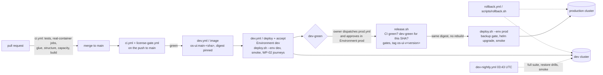

<!--
SPDX-License-Identifier: Apache-2.0
Copyright 2026 Borek Data Ventures UG (haftungsbeschränkt)
-->
# CI/CD: pull request, dev, production

Each commit passes through the same gates in a fixed order. Production runs only the image
bytes that dev already ran its acceptance suite on.



## Stage 1: pull request (exists; unchanged)

`.github/workflows/ci.yml` runs on every pull request and on every push to `main`:

- the unit tests (`test-ui`), including the deploy, release, env-guard and dev-bootstrap script
  tests;
- the real-container jobs (`test-langgraph-pg`, `test-opensearch`, `tracing-e2e`,
  `test-postgres`, `test-opa`, `validate-generated`, the image jobs);
- the glue, structure and capacity gates;
- `helm-lint` and `secret-scan`;
- the `build` aggregator, which fails if any job it needs did not succeed.

`license-gate.yml` and `cla.yml` run beside it. The ruleset on `main` requires `build`,
`helm-lint`, `secret-scan`, `license-gate` and `cla` (read 2026-11-20). This change adds two
lines to the existing test step and changes nothing else in stage 1.

## Stage 2: dev, on every push to main

`.github/workflows/dev.yml` has three jobs.

1. **`image`** calls `build-images.yml` as a reusable workflow. Its `require-green-ci` job waits
   until `ci.yml` and `license-gate.yml` have passed on `main` for this SHA. Then it builds
   `os-ui:main-<sha>` and runs the worker smoke on the built image. It also checks that the
   pushed image is the image that was smoked, and pushes it. The digest is a job output.
2. **`deploy + accept (dev)`** runs in the GitHub Environment **`dev`**:
   - `scripts/deploy.sh --env dev --from-registry main-<sha>`. The env guard refuses any cluster
     that is not the marked dev cluster. The capacity gate runs against `capacity.dev.yaml`.
     The command is `helm upgrade --install` with `values.dev.yaml` plus the private overlay,
     which is read from the dev cluster.
   - `scripts/smoke-test.sh --env dev --expect-tag main-<sha>`.
   - The WP-02 journeys AT-a … AT-f against dev (`E2E_KUBE_CONTEXT=dmagosdev`). The
     expected-fail markers apply, as on kind.
   - The deploy record (`revision_before`, `revision_after`, the image and its digest, and the
     rollback command), the smoke output and the acceptance report go to the job summary and to
     the `dev-report` artifact.
3. **`dev-green`** succeeds only when `image` and `deploy` both succeeded. **This job is what
   "green on dev" means.**

**Concurrency.** The `image` stage of an older push is cancelled by a newer one
(`dev-image`, cancel-in-progress). There is one deploy at a time (`dev-environment`). A running
deploy is never cancelled, because a cancelled `helm upgrade` leaves the release pending. A
newer push does replace a deploy that is still waiting. The nightly run shares
`dev-environment`, so it never overlaps a deploy.

**Enabling.** Until the repository variable `DEV_ENVIRONMENT_ENABLED` is `true`, every job is
skipped. A run with skipped jobs does not count as green on dev, because the gate requires the
`dev-green` *job* to have concluded `success`.

## Stage 3: production, by manual dispatch, approved by the owner

`.github/workflows/prod.yml` is started from Actions with the inputs `version` and, optionally,
`sha`. It runs in the GitHub Environment **`prod`**, which has the owner as required reviewer.
The job waits for that approval before it can read `PROD_KUBECONFIG`. It then runs the
**existing** gate, `scripts/release.sh --remote origin --sha <sha> <version>`, with
`RELEASE_PROMOTE_IMAGE=1`. The script stops at the first gate that fails:

1. The checkout is clean, and the commit is on `main`.
2. The tag `os-ui-v<version>` is free.
3. `ci.yml` and `license-gate.yml` passed on the push to `main` for this SHA.
4. **The dev gate.** `dev.yml`'s `dev-green` job passed for this exact SHA. The gate refuses a
   red dev run (`NOT_GREEN_ON_DEV`), one that has not finished or never ran, one that was
   cancelled by a newer merge, and one whose `dev-green` job was skipped. `--no-dev-gate`
   exists for a local run while dev does not exist yet; the gate refuses it under CI or
   `GITHUB_ACTIONS`.
5. The structure, consoles and capacity gates pass, and there is no cloud-sync duplicate.
6. The script tags the commit. It then gives the **dev image** `main-<sha>` the version tag:
   `scripts/lib/promote-image.sh` copies it in the registry, keeps the digest, and refuses to
   move an existing tag. **There is no rebuild.**
7. `scripts/deploy.sh --env prod --from-registry <version>`: the env guard, the capacity gate,
   the pre-upgrade backup, `helm upgrade`, the rollout.
8. `scripts/smoke-test.sh --env prod --expect-tag <version>`.

The Helm revision before the deploy is recorded in the job summary and in the `deploy-record`
artifact.

**The local path keeps working.** An operator can still run `scripts/release.sh <version>` on a
laptop. The tag push then starts `build-images.yml`, which now **reuses** `main-<sha>` when the
dev stage built it, so the result is the same digest. It builds the image only for commits older
than the dev stage. Until dev exists, a local release needs `--no-dev-gate`, and the script
says so loudly.

Tests: `scripts/tests/release.test.sh` covers the cases above. Its negative twins check that a
commit that is red on dev, never ran on dev, was cancelled, or had `dev-green` skipped is
refused with no tag and no deploy, and that `--no-dev-gate` is refused in CI.

## Stage 4: nightly

`.github/workflows/dev-nightly.yml` runs at 03:43 UTC, and on demand, against what runs on dev.
It deploys nothing. It runs:

- the full acceptance suite with the expected-fail markers dropped (`E2E_IGNORE_XFAIL=1`);
- every WP-56 restore-drill CronJob present on dev (`restore-drill`, `velero-drill`), once each
  as a Job. Until WP-56 is merged and `backup.drill` is enabled on dev, the summary says
  "not on dev";
- the smoke test.

The results go to the job summary and the artifact. A failure opens one issue labelled
`dev-nightly`, or comments on it if it is already open.

## Stage 5: rollback, one command per environment

```bash
scripts/rollback.sh --env dev                # one Helm revision back
scripts/rollback.sh --env prod --to <rev>    # revision_before from the deploy record
```

From GitHub, use the `rollback` workflow (`env`, optional `to`). A prod rollback waits for the
`prod` reviewer. The rollback runs the same env guard, and in prod it first takes the
pre-upgrade backup. It restores manifests (images, config, values), not data.

## Owner checklist: GitHub settings

Nothing below is changed by this PR or by an agent. The owner does each step in **Settings**.

1. **Environment `dev`** (Settings → Environments → New environment → `dev`):
   - Deployment branches: **Selected branches → `main`**.
   - Secret **`DEV_KUBECONFIG`**: the output of `scripts/dev/ci-kubeconfig.sh`. It is a
     ServiceAccount of the dev cluster only, so it is not valid anywhere else.

     ```bash
     gh secret set DEV_KUBECONFIG --env dev --repo Data-Masterclass/sovereign-agentic-os \
       < ~/.sovereign-os-secrets/dev/ci-kubeconfig.yaml
     ```

   - No reviewers: every merge deploys.
2. **Environment `prod`**:
   - Required reviewers: **the owner** (`aborek`). Turn on **Prevent self-review** if a second
     maintainer exists.
   - Deployment branches: **`main` only**.
   - Secret **`PROD_KUBECONFIG`**: a dedicated ServiceAccount kubeconfig of the production
     cluster, for the deploy only (the same recipe as `scripts/dev/ci-kubeconfig.sh`, run by the
     owner on production). Do not use a personal admin kubeconfig. Revoke it by deleting its
     token Secret.
     - Least privilege: the chart creates cluster-scoped objects (PriorityClasses, the
       `agentic-apps` namespace, RBAC), so the deploy needs cluster-admin on that cluster.
     - The protection is the environment instead: only `main`, only after the owner approves,
       and only through `release.sh`'s gates.
   - **If you prefer that GitHub never holds a production credential**, leave `PROD_KUBECONFIG`
     unset. The prod workflow then stops at its kubeconfig step, and the local
     `scripts/release.sh` path does the same release, with the same dev gate.
3. **Repository variable** `DEV_ENVIRONMENT_ENABLED=true` (Settings → Variables → Actions), set
   once dev is up. Until then the dev stage is skipped.
4. **Required status check on `main`.** `build` is already required (with `helm-lint`,
   `secret-scan`, `license-gate` and `cla`), so keep it. **Do not** add `dev-green` as a
   required check: it runs after the merge, on `main`, and it gates production through
   `release.sh`.
5. **The ruleset "main protection"** (read 2026-11-20): it requires 1 approving review,
   code-owner review and conversation resolution, linear history and the five checks above, and
   it has a bypass for the repository **Admin** role with mode **always**. The recommendations:
   - Change the Admin bypass to **"For pull requests only"** (`bypass_mode: pull_request`).
     An admin can then still merge a PR in an emergency, but can no longer push to `main`
     directly, so every commit on `main` has passed the PR checks and goes through dev.
   - Keep 1 required review.
   - Keep `strict_required_status_checks_policy` (branches must be up to date).
6. **A tag ruleset** for `os-ui-v*`: restrict creation and deletion to admins and the
   `github-actions` app, and block updates (tags are immutable). A release tag can then only
   come from `release.sh`.
7. **Actions permissions**: keep "Read repository contents" as the default token permission.
   The workflows ask for exactly what they need (`dev.yml`: `packages: write`, `actions: read`;
   `prod.yml`: `contents: write` to push the tag, `packages: write` to tag the image).

## What is verified, and how

- **`actionlint`** is clean on `dev.yml`, `prod.yml`, `dev-nightly.yml`, `rollback.yml` and
  `build-images.yml`. Two older findings in `ci.yml` and `e2e-kind.yml` existed before this
  change; they are not ours and were not touched.
- **Script tests** (no cloud, no cluster; they run in `ci.yml`):
  - `scripts/tests/release.test.sh`: the dev gate and its negative twins, promotion with no
    rebuild, `--sha`, `--env dev`.
  - `scripts/tests/env-guard.test.sh`: a dev deploy with the prod context is refused, and so
    are a renamed context on the prod API server, an unmarked cluster, prod on dev, smoke and
    rollback, and the harness.
  - `scripts/tests/dev-bootstrap.test.sh`: refusals, mode 600/700, no chart literal left, the
    synthetic cast only, the dev capacity gate.
  - The existing deploy tests still pass.
- **Not verified live.** No dev cluster exists yet, and no workflow in this change has run on
  GitHub. The first `dev.yml` run after `DEV_ENVIRONMENT_ENABLED=true` is its live proof.
